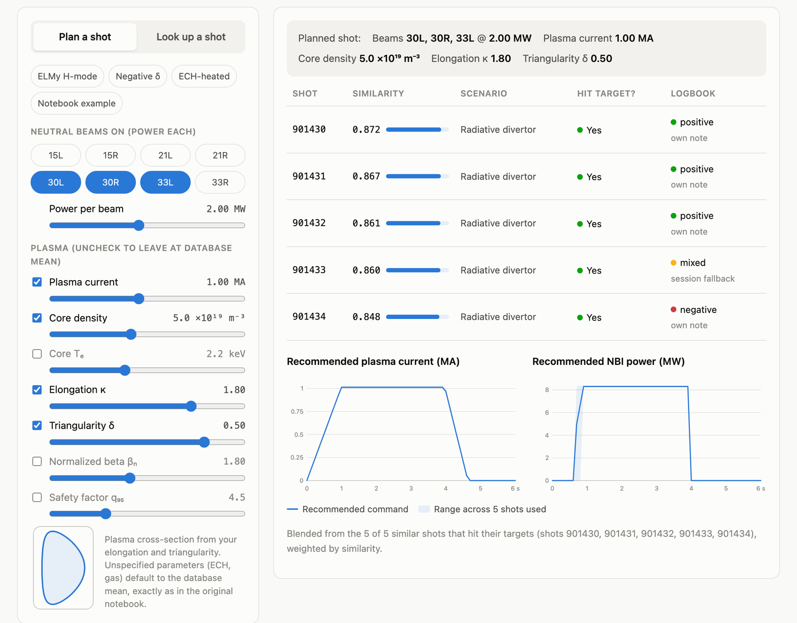
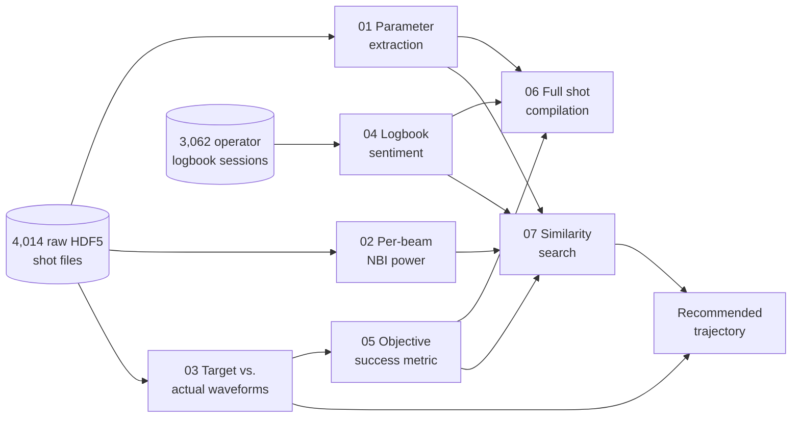
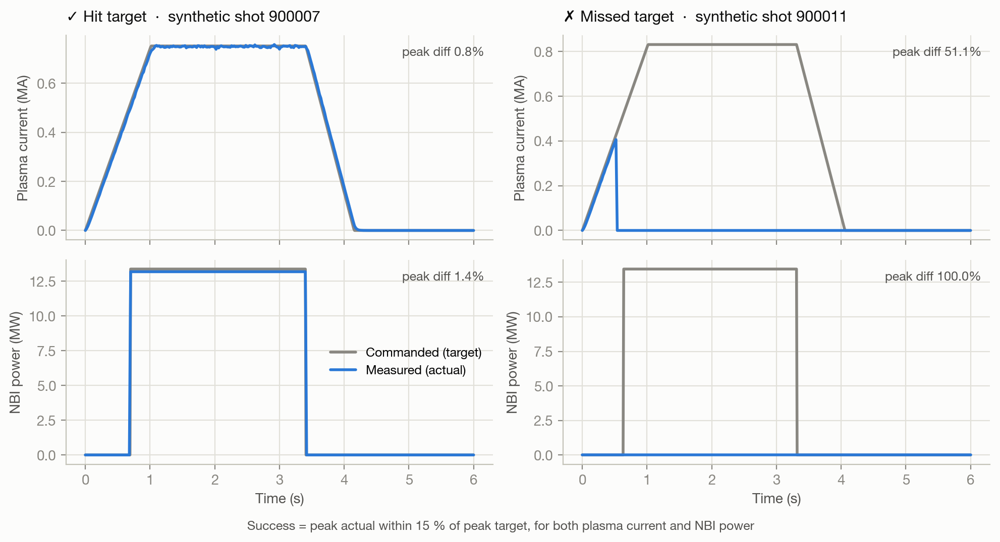
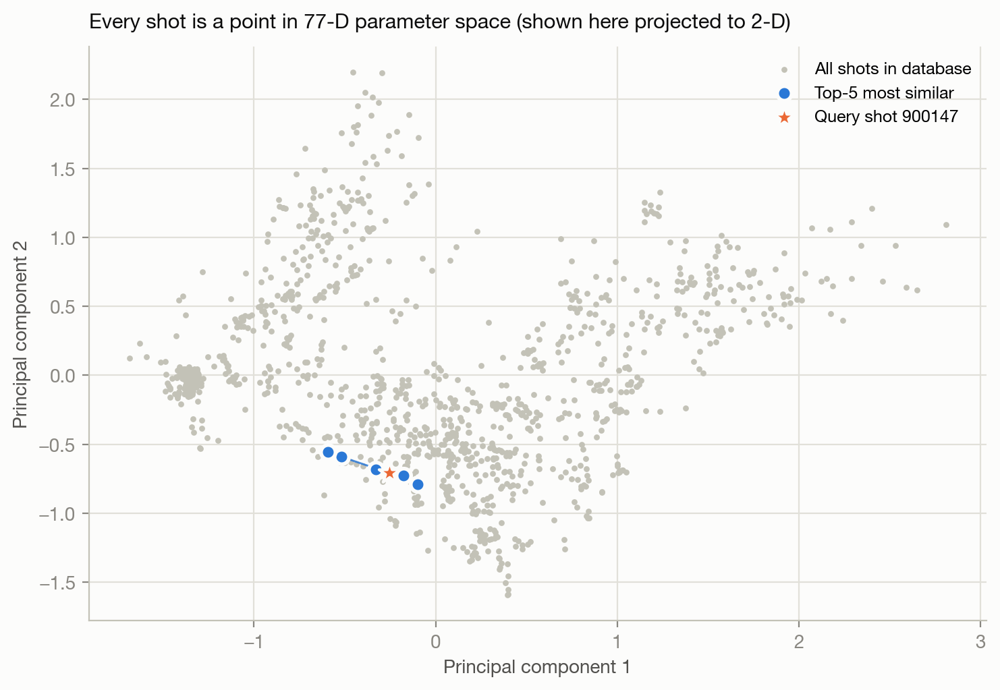
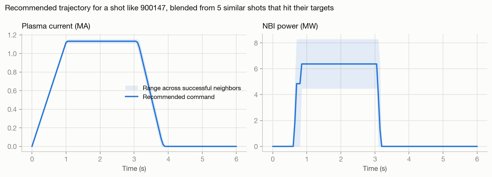
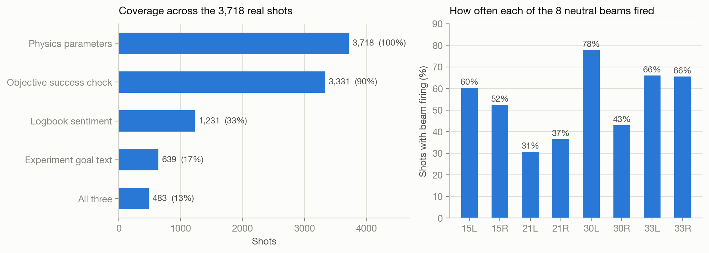

# Tokamak Shot Recommender

**A search engine for DIID Experiment Runs.** A physicist can describe how the DIII-D tokamak is be set up that day, and this system finds the five most similar past shots based on selected physics parameters, determines which past shots  actually hit their targets, and recommends a plasma-current and beam-power program to command.

Built solo during my Summer 2026 research internship at the **Princeton Plasma Physics Laboratory (PPPL)**, using data from the **DIII-D National Fusion Facility**.

### [▶ Try the live demo](https://i-askari.github.io/tokamak-shot-recommender/#demo) · [Project page](https://i-askari.github.io/tokamak-shot-recommender/)

[](https://i-askari.github.io/tokamak-shot-recommender/#demo)

---

## At a glance

| | |
|---|---|
| **Problem** | DIII-D has run hundreds of thousands of historic plasma shots, but the history lives in raw HDF5 diagnostic time series and free-text operator logbooks. There was no way to ask *"has anyone run a shot like this, and was it sucessful"* |
| **What I was given** | Access to the raw data: 4,014 HDF5 shot files and 3,062 logbook sessions (2012–2026) on Princeton's Stellar HPC cluster. |
| **What I built** | Everything else. A 7-stage pipeline: physics parametrization → per-beam heating → target-vs-actual extraction → logbook sentiment → objective success metric → shot compilation → cosine-similarity search. |
| **Scale** | 3,718 shots parametrized into a **77-dimensional physics feature vector**; 3,331 shots scored for objective success; 53,384 shots scored from operator notes. |
| **Stack** | Python, NumPy, pandas, scikit-learn, h5py, BeautifulSoup, Jupyter, Slurm/HPC; vanilla JS + SVG for the web demo. |

## How it works



Every stage reads only the CSV/JSON checkpoints written by earlier stages, so any stage can be rerun alone without another pass over 4,000 HDF5 files.

### 1. Parametrize messy signals into physics features
Raw diagnostics are time series with different lengths, sample rates and units, plus spikes and dropouts. Each signal is reduced to a **95th-percentile "peak"** (robust to single-sample spikes, unlike `max`) and a **mean** over the 0–6 s plasma window:

| Family | Features | Source |
|---|---|---|
| Kinetic profiles | Core + tangential electron temperature T<sub>e</sub> and density n<sub>e</sub> | Thomson scattering |
| Plasma current | I<sub>p</sub> | Magnetics |
| Equilibrium shape | Elongation κ, upper/lower triangularity δ, normalized beta β<sub>N</sub>, safety factor q<sub>95</sub> | EFIT reconstruction |
| Neutral-beam heating | Absorbed power for each of **8 beams** | NBI system |
| Electron-cyclotron heating | Forward power for each of **12 gyrotrons** | ECH system |
| Fueling | Flow for each of **11 gas valves** | Gas system |

→ **88 columns** per shot from stage 1, **104** after the per-beam addendum, and a **77-D vector** used for search.

### 2. Define "success" objectively
Logbooks are subjective and sparse, so I built an objective check: interpolate the measured waveform onto the commanded timestamps and require **peak actual within 15 % of peak target**, independently for plasma current and total NBI power. Before building on the target signals, I validated them against known values on reference shots (beam power matched to 1–2 %, consistent with beam shine-through losses).



### 3. Read the operators' notes, per shot
Each logbook entry is tagged `Shot <number> <ROLE>:`, so I attribute notes to the **specific shot** they describe. Shots with no note of their own inherit the session summary's sentiment, **explicitly labeled** as lower-quality signal. Keywords were tuned for plasma vocabulary (*mode* and *clean* removed after false hits on "H-mode" and "wall cleaning").

### 4. Search, then recommend
Features are min-max normalized and ranked by **cosine similarity**. You can query by an existing shot number or by planned settings (unspecified ones default to the database mean). Results come back enriched with objective success and logbook sentiment.

The **trajectory recommendation** keeps the neighbors that hit their targets and blends their *commanded* I<sub>p</sub> and NBI waveforms, weighted by similarity. The spread across those shots is shown as a band, so the operator can see how much the shots disagreed.

| Neighbors cluster by session in 77-D space | Recommended command program |
|---|---|
|  |  |

## Results on the real archive



- **3,718 / 4,014** shot files parametrized. All 292 failures were corrupt or truncated HDF5 files, and each one was logged.
- **3,331** shots received an objective success score: **2,426 hit target, 905 missed.**
- **53,384** shots scored from logbooks: 40,859 from their own notes (76.5 %), 12,525 via labeled session fallback.
- **Sanity check passed:** the nearest neighbor of real shot 144229 was **144230**, the next shot in the same session, followed by a cluster from a related session (similarity 0.93–0.96).
- **Reported honestly:** only 483 shots (13 %) have goal text, sentiment, *and* a success score. I traced this to a scope mismatch between the logbook archive (2012–2026) and the narrower HDF5 slice, so it is a data-coverage gap and not a pipeline bug.

## Engineering decisions

- **Validate a signal before trusting it.** Target signals were cross-checked on reference shots before any scoring depended on them.
- **Fail one beam, not the whole shot.** About 15 shots had beam data and time arrays of mismatched length (e.g. 131,072 samples vs. 2 timestamps). A guard skips only that beam, which took the per-beam pass from crashing to 3,718 / 3,718 succeeded.
- **Checkpoint every stage** so scoring and search can be iterated without re-reading the raw archive.
- **Label uncertainty instead of hiding it.** Sentiment carries its source; every compiled field is flagged available/unavailable.

## Limitations & next steps

- **Time-resolved success.** A peak-based check can call a shot successful even if it disrupted late in the flattop. A tracking-error metric over the whole waveform would catch that.
- **Missing vs. off.** Zero currently means both "beam off" and "diagnostic missing." Separating the two (masking, or imputation) would sharpen matches.
- **Feature weighting.** All 77 features count equally in cosine similarity. Learning weights from outcomes, or trying standardized Euclidean distance or a learned embedding, is the obvious next experiment.
- **Coverage.** Extend the HDF5 extraction to the full 2012–2026 span to close the 13 % complete-profile gap.

## Repository layout

```
notebooks/                  The original 7-stage pipeline as run on the real archive
  01_shot_parameter_extraction.ipynb   raw HDF5 → 88 physics columns per shot
  02_per_beam_nbi_power.ipynb          + absorbed power for each of 8 beams
  03_target_vs_actual_extraction.ipynb commanded vs. measured Ip and NBI waveforms
  04_logbook_sentiment_analysis.ipynb  per-shot operator-note sentiment
  05_shot_success_metric.ipynb         objective hit/miss within 15 %
  06_shot_full_compilation.ipynb       goal + sentiment + success per shot
  07_similarity_search.ipynb           cosine-similarity search (the payoff)
shot_recommender/           The core algorithms as a small, tested Python package
  parameters.py             the 77-feature parametrization
  success.py                success metric           (from notebook 05)
  sentiment.py              logbook parsing/scoring  (from notebook 04)
  similarity.py             ShotIndex search         (from notebook 07)
  trajectory.py             trajectory recommendation from successful neighbors
  synthetic.py              synthetic database generator for the public demo
scripts/build_assets.py     regenerates figures, synthetic CSVs and the demo data
tests/                      pytest suite
docs/                       GitHub Pages site with the interactive demo
data/synthetic/             synthetic CSVs with the same schema as the real outputs
```

## Run it yourself

```bash
pip install -r requirements.txt
pytest                              # 10 tests
python scripts/build_assets.py      # regenerate synthetic data, figures, demo JSON
python -m http.server -d docs 8000  # open http://localhost:8000
```

```python
from shot_recommender import ShotIndex, recommend_trajectory
from shot_recommender.synthetic import generate_dataset

d = generate_dataset()
index = ShotIndex(d["params"], d["success"], d["sentiment"])

# "Beams 30L + 30R at 2 MW, 1 MA plasma current, elongation 1.8"
matches = index.match_specs({"peak_pabs_NB30L": 2e6, "peak_pabs_NB30R": 2e6,
                             "peak_ip": 1e6, "kappa": 1.8})
plan = recommend_trajectory(matches, d["series"])
```

## Data & confidentiality

The DIII-D archive and operator logbooks are restricted research data, so **none of it is included here**. The notebooks are published with outputs cleared and cluster paths replaced by placeholders. The demo and all figures except "Results on the real archive" use a **synthetic database** (`shot_recommender/synthetic.py`) with the same schema, generated from simple physics scalings and pushed through the same parametrization, success and sentiment code. Synthetic shot numbers start at 900000 and do not describe real experiments.

## Acknowledgments

Thanks to my mentors at PPPL and the Princeton plasma control group, and to the DIII-D National Fusion Facility team whose data made this possible.
